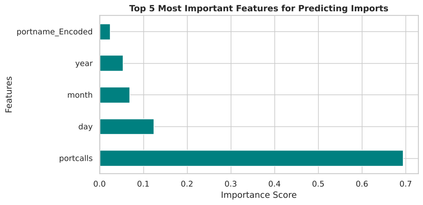
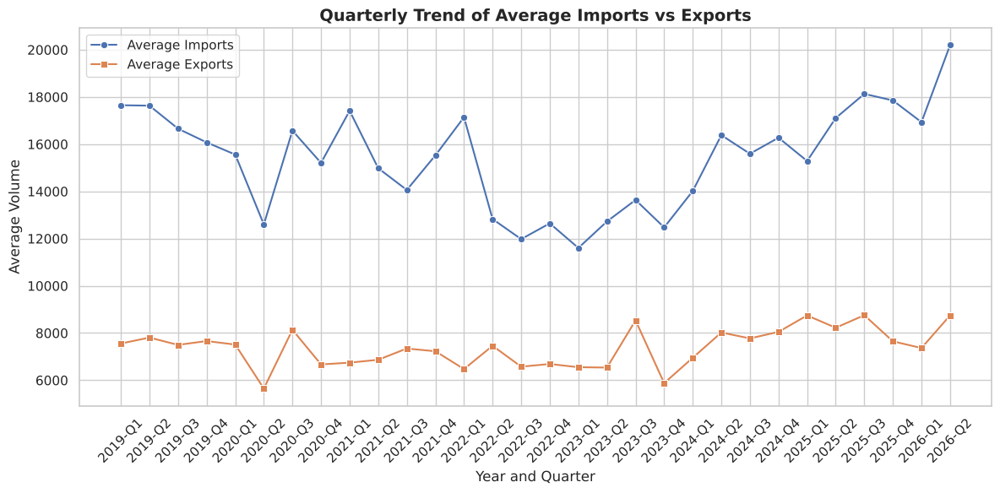

# Analysis & Prediction of Sri Lankan Port Activity

A complete data science workflow (cleaning, preprocessing, EDA, hypothesis testing and machine learning) on daily Sri Lankan port activity data, predicting total daily import volume.

**Group 06 | NIBM City University | Numerical Mathematics and Computing (HNDCSAI26.1)**
Pasindu Bandara · Ashen Kurukulasuriya · Abhimani Konara · Anutthara Subasinghe

## Dataset
- **Source:** [IMF PortWatch](https://portwatch.imf.org) (IMF & University of Oxford), daily port activity and shipment estimates derived from satellite ship-tracking data.
- 10,824 daily records, 2019-01-01 to 2026-05-29, for 4 ports: Colombo, Hambantota, Trincomalee, Galle.
- About 61% of port-days have zero imports (mostly the smaller ports).

## What was done
1. **Data cleaning:** no missing values or duplicates; dropped `country`, `ISO3`, `portid`.
2. **Feature engineering:** `Day_Type`, `Quarter`, `Activity_Level` (33rd/66th percentiles of port calls), `Dominant_Cargo`; Label Encoding for categorical columns.
3. **Chronological 80/20 train-test split** to avoid data leakage.
4. **EDA:** import distribution, activity level by port, quarterly import/export trend, correlation heatmap.
5. **Hypothesis testing (α = 0.05):**
   - Welch t-test, weekday vs weekend imports: p = 0.017, significant difference.
   - One-way ANOVA, imports by quarter: p = 0.88, no significant difference.
6. **Models:** Linear Regression vs Random Forest (100 trees).

## Results
| Metric | Linear Regression | Random Forest |
|---|---|---|
| MAE | 9,673.26 | **8,981.87** |
| MSE | **326,769,792** | 335,380,962 |
| R² | **0.6186** | 0.6085 |

Both models perform similarly. Random Forest has the lower MAE; Linear Regression has the slightly better R² and MSE. In the Random Forest, `portcalls` is by far the most important feature, followed by `day`.




## Limitations and next steps
- `Activity_Level` is derived from `portcalls`, so the two features overlap.
- Many zero-rows from small ports.
- Add weather, fuel prices and macroeconomic indicators; try ARIMA / LSTM.

## Run it
```bash
pip install -r requirements.txt
jupyter notebook port_activity_analysis.ipynb
```

## Files
- `port_activity_analysis.ipynb`: full analysis
- `data/`: dataset (IMF PortWatch)
- `images/`: charts
